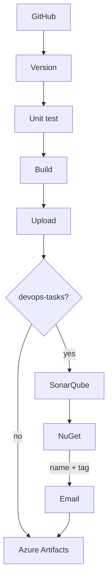
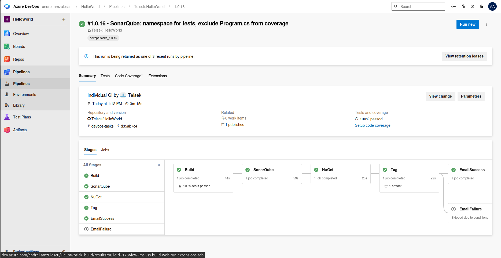
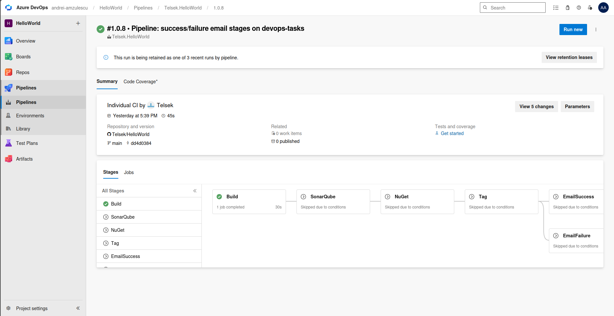
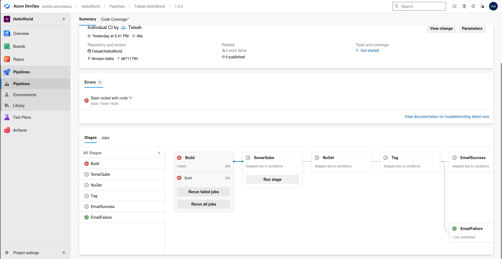
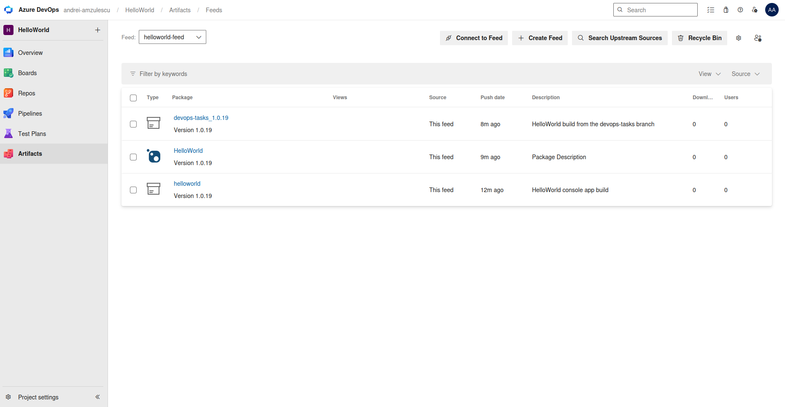
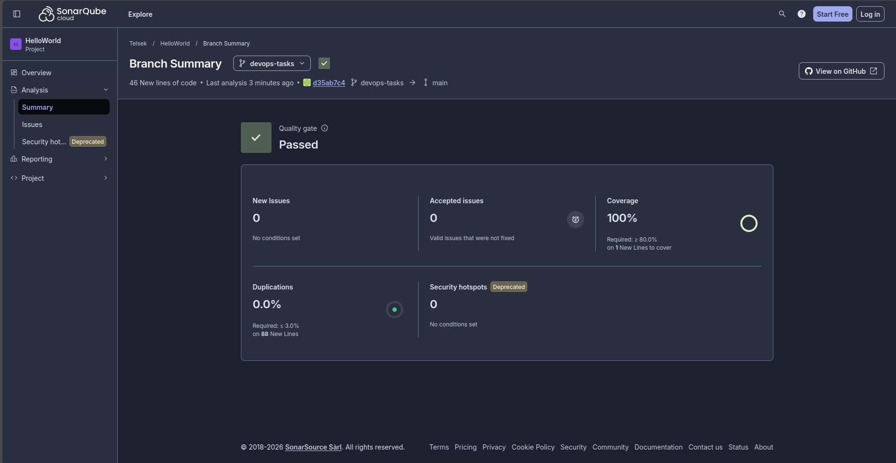
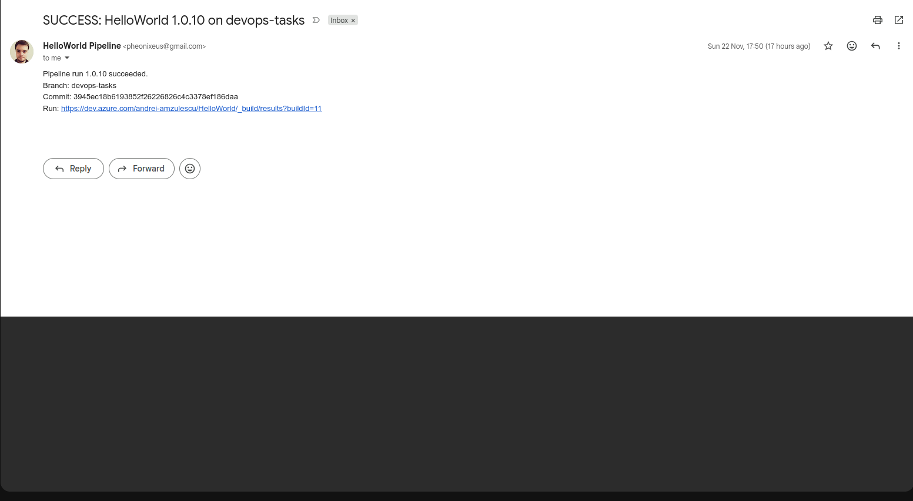
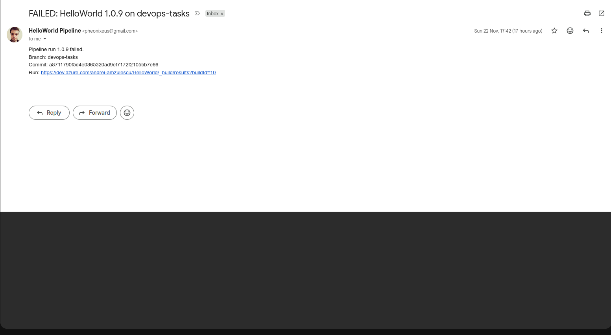
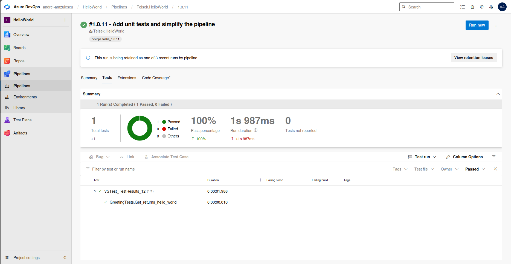
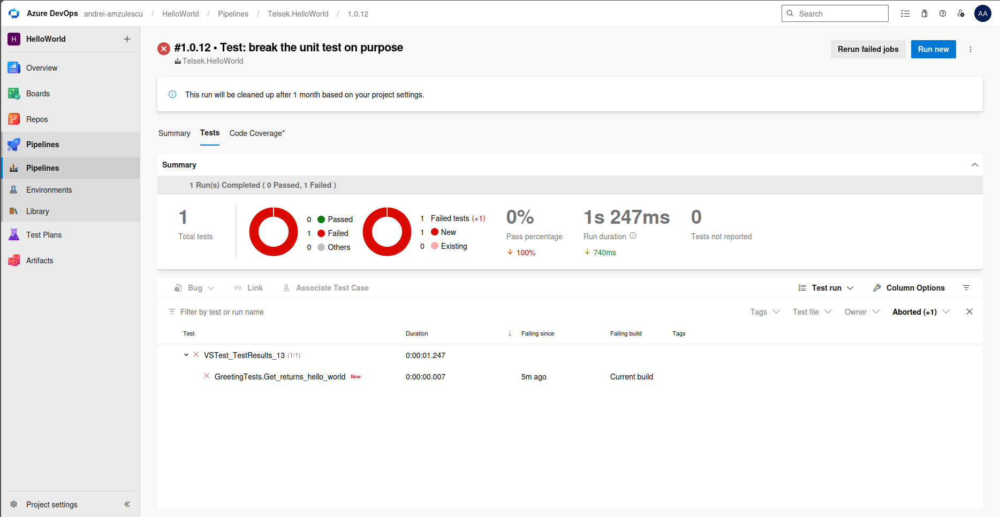

# HelloWorld Azure Pipeline <!-- omit from toc -->

Hello World app in .NET 10 with an Azure DevOps pipeline.

## Index <!-- omit from toc -->

- [What it does](#what-it-does)
- [Diagram](#diagram)
- [Screenshots](#screenshots)
- [Burndown](#burndown)
- [Notes](#notes)

## What it does

On every push the pipeline gives the app a version (1.0.1, 1.0.2...), runs the unit test, builds the app and uploads it to Azure Artifacts. If the test fails, nothing is uploaded.

On the `devops-tasks` branch it also:

- runs a SonarQube scan
- makes a NuGet package and uploads it to Azure Artifacts
- tags the run and uploads the build to Azure Artifacts as `devops-tasks_<version>`
- sends an email if the run passed or failed

On other branches these steps are skipped. The pipeline is in `azure-pipelines.yml`.

## Diagram

## Screenshots

Run on devops-tasks:

Run on main:

Failed run:

Azure Artifacts:

SonarQube:

Emails:

Unit test passed:

Unit test failed, nothing was uploaded:

## Burndown

1. Setup: Azure DevOps project, .NET 10, VS Code
2. App and GitHub repo
3. Feed and first pipeline (version, build, upload)
4. devops-tasks branch
5. SonarQube stage
6. NuGet stage
7. Tag stage
8. Email stages
9. Tests on main and devops-tasks, broken build test
10. Extra: unit test project, test step in the pipeline, test coverage in SonarQube
11. Fixed the new SonarQube findings and made the pipeline simpler

## Notes

- I used SonarQube Cloud, it's free and doesn't need a server.
- Emails are sent with Gmail. The password is a secret in Azure DevOps, not in the repo.
- I used VS Code because Visual Studio doesn't run on Linux.
- SonarQube found the Sonar tasks weren't pinned to a version, so I pinned them.
- My extra is a unit test. Before it SonarQube showed 0% coverage, now it's 100%.
- SonarQube also found that the branch name was used straight in a script. I pass it through an environment variable now.
- Program.cs only starts the app, so it's left out of the coverage.
